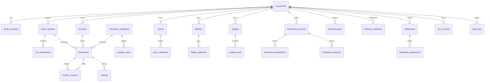

# 数据模型

## ER 概览

## 关键不变量

1. **金额**：`*_minor` 为最小货币单位整数（CNY=分），禁止浮点。金额始终为正，
   方向由 `direction` 表达。
2. **多币种**：`amount_minor`（原币）+ `currency` + `fx_rate` + `amount_base_minor`（本位币）
   四列并存；缺少汇率时挂起待确认，不做隐含换算。
3. **交易归属**：`account_id` 必填；`payer_member_id` / `owner_member_id` / `beneficiary`
   分离“付款人 / 账户所有人 / 消费受益人”。
4. **软删除**：`is_deleted` + `status=void`，审计日志保留 before/after。
5. **估值历史**：`asset_valuations` 追加写；`assets.current_value_minor` 只向前推进。
6. **预算版本**：`(household, period_type, period_start, version)` 唯一；旧版本 `superseded`。
7. **结算**：`(household, period)` 唯一；`CLOSED` 后仅能通过 `reopen` 修改。
8. **同步**：`(entity_type, entity_id, direction)` 唯一，保存 `payload_hash` 与
   `remote_record_id`，冲突时 `status=conflict`。

## 表清单（26）

`households`, `family_members`, `accounts`, `import_batches`, `raw_transactions`,
`transactions`, `transaction_categories`, `category_rules`, `transfer_matches`,
`refunds`, `assets`, `asset_valuations`, `liabilities`, `liability_payments`,
`budgets`, `budget_items`, `investment_products`, `investment_transactions`,
`investment_positions`, `financial_goals`, `financial_snapshots`, `sync_records`,
`audit_logs`, `system_configs`, `settlements`, `settlement_adjustments`.

## 交易类型

`expense`, `income`, `refund`, `reversal`, `transfer`, `credit_card_repayment`,
`topup`, `withdrawal`, `investment_buy`, `investment_sell`, `loan_out`,
`loan_repay`, `fee`, `unknown`。

只有 `income` / `expense` / `refund` / `fee` 参与收支统计；
`transfer`、`credit_card_repayment`、`topup`、`withdrawal`、投资买卖、借贷不计入。

## 状态

- 交易：`confirmed` / `pending_review` / `void` / `reversed`
- 导入：`pending` / `parsing` / `importing` / `imported` / `failed` / `duplicate`
- 结算：`COLLECTING` / `IMPORTING` / `RECONCILING` / `REVIEW_REQUIRED` / `READY_TO_CLOSE` / `CLOSED`
- 同步：`pending` / `synced` / `failed` / `conflict` / `skipped`

## 迁移

- Alembic 初始版本 `0001_initial` 直接物化 SQLAlchemy metadata，避免模型与库漂移；
- 后续变更必须新增显式 revision，使用 `render_as_batch=True`（SQLite 限制）；
- 启动/初始化时 `upgrade head`，`system_configs.schema_version` 记录当前版本。
